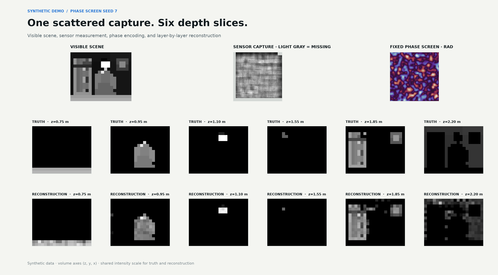
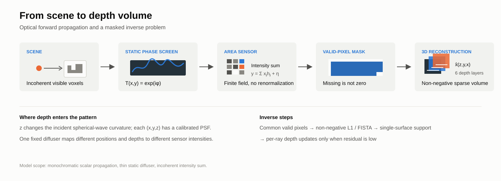

# Lens-Free Scattering Imaging: Technical Demo

This repository collects a numerical demonstration of lens-free imaging with a static random phase diffuser. It covers depth-dependent point-spread functions (PSFs), incomplete sensor pixels, and recovery of a 3D brightness volume from one 2D intensity image. All results are synthetic, not measurements from physical hardware.

[简体中文](README.zh-CN.md) · [Public index](README.md)

## Simulated scene

The scene represents a video-meeting room with a seated person, bookshelf, books, plant, wall decoration, and desk edge. A front-view visibility rule keeps only the nearest visible surface at each `(x,y)` location. The voxel grid contains 20×16 lateral locations and 6 depths, for 1,920 candidate voxels. Depths are `0.75, 0.95, 1.10, 1.55, 1.85, 2.20 m`; volumes use `(z,y,x)` axis order.



The figure compares the visible surface, sensor capture, phase screen, and true and reconstructed depth slices. Missing sensor samples appear in light gray. See [the full reconstruction figure](assets/meeting_scene_results.png) for the original overview.

## Optical forward model



The diffuser is a fixed thin random phase screen, `T(x,y)=exp(i φ(x,y))`. The spatially correlated phase screen modulates a spherical wave emitted by a point source `(x_s,y_s,z)`. The source-to-diffuser distance `z` changes wavefront curvature:

```text
r(x,y) = sqrt((x-x_s)^2 + (y-y_s)^2 + z^2)
U_d(x,y) ∝ exp(i 2π r / λ) / r
```

The incident field is normalized to unit discrete energy over the diffuser samples and multiplied by the phase transmission. Propagation from diffuser to sensor uses the angular-spectrum method:

```text
U_s = F^-1{ F{U_d T} H(f_x,f_y) }
H = exp(i k L sqrt(1 - (λ f_x)^2 - (λ f_y)^2))
```

Here `L` is the diffuser-to-sensor distance and `k=2π/λ`. Zero-padding reduces FFT wraparound, and evanescent frequencies are omitted. A point-source PSF is the sensor-plane intensity `h_j=|U_s|^2`. Energy outside the finite sensor is not renormalized, so the PSF sum records the captured fraction.

Incoherent scene intensities add linearly: `y = Σ_j x_j h_j + η`. Here `x_j` is a voxel brightness coefficient and `η` represents photon sampling and optional read noise. Calibration and measurement pixels must both be valid to enter the fit. Missing pixels are masked, not replaced with zeros.

## Reconstruction steps

1. **Voxel calibration:** simulate one PSF for every `(x,y,z)` position. Depth changes the incident spherical-wave curvature and therefore the measured pattern.
2. **Mask and normalization:** fit only pixels valid in the measurement and all relevant PSFs. PSF columns are L2-normalized internally and converted back to brightness units on output.
3. **Non-negative sparse inverse:** FISTA approximately minimizes `0.5 ||D x-y||² + λ||x||₁`, subject to `x≥0`. An optional quadratic penalty smooths x/y neighbor differences independently within each depth slice.
4. **Single-surface support:** for opaque scenes, select the maximum-estimated depth at each `(x,y)` ray from the initial volume, then refit brightness using only those selected PSFs.
5. **Residual-gated depth updates:** if the initial valid-pixel residual is below the configured threshold, compare each ray's calibrated depths using the L1 objective score after removing that ray's current contribution. Otherwise keep the initial support. Updates use a deterministic randomized sweep and stop at the step limit or when no coefficient or depth changes.

The final step is a local coordinate optimization. It depends on the initial support and noise and has no global-optimality guarantee. It requires `single_surface=True` and is not appropriate for transparent or multi-depth rays.

## Default setup and headline result

| Parameter / metric | Value |
| --- | ---: |
| Wavelength | 532 nm |
| Sensor and diffuser sampling | 96×96, 8 μm pixel pitch |
| Diffuser-to-sensor distance | 3 mm |
| Phase-screen standard deviation / correlation length | 2.5 rad / 2 px |
| Valid sensor samples | 8,136 / 9,216 |
| Photon-count parameter | 500,000 |
| Relative L1 / spatial smoothness | 0.003 / 0.03 |
| Depth-refinement steps / residual threshold | 6 / 0.05 |
| Seed-7 relative volume error | 0.249 |
| Seed-7 depth argmax accuracy | 0.944 |
| Seed-7 relative sensor residual | 0.0163 |

| Phase seed | Baseline volume error, no Gaussian noise | Gated-refined volume error | Baseline depth accuracy | Gated-refined depth accuracy |
| ---: | ---: | ---: | ---: | ---: |
| 7 | 0.2595 | 0.2546 | 0.9344 | 0.9500 |
| 12 | 0.2701 | 0.2567 | 0.9094 | 0.9219 |
| 13 | 0.2723 | 0.2588 | 0.9125 | 0.9344 |
| 14 | 0.3199 | 0.3064 | 0.9094 | 0.9187 |

[View the depth-error reduction figure](assets/depth-error-reduction.en.png) · [Download all per-seed/noise values](data/depth_stability_sweep.en.csv). Gaussian noise levels `0.002` and `0.005` are stress-test values in normalized measurement units, not read-noise values calibrated to a specific camera. Under these conditions, the initial sensor residual exceeds `0.05`, so the gate skips depth updates. Noise still substantially reduces absolute depth accuracy.

## Animation and data

[Watch the English animated demo](assets/demo.en.gif). The Chinese version is [demo.zh-CN.gif](assets/demo.zh-CN.gif). These are silent GIF animations, not recorded camera footage.

[`meeting_scene_results.npz`](data/meeting_scene_results.npz) is about 55 MB. It contains the phase screen, coordinates, partial calibration PSFs, sensor mask, measurement, true volume, reconstructed volume, and primary settings. Main array shapes are `calibration_psfs_partial=(1920,96,96)`, `measurement=(96,96)`, `true_volume=(6,16,20)`, and `reconstructed_volume=(6,16,20)`. Per-seed metrics are in `depth_stability_sweep.en.csv`.

## Reproducibility and limitations

The default demo uses phase-screen seed 7 and Poisson-sampler seed 8. A phase seed changes the PSF dictionary and therefore the optical encoding; photon noise adds another realization. Metrics are computed against synthetic ground truth. Physical experiments generally do not have a per-pixel ground-truth volume.

The model assumes monochromatic scalar propagation, a static thin phase screen, and incoherent visible-surface brightness. It does not model broadband light, multiple scattering inside a thick diffuser, shadows, inter-reflections, saturation, or dark current. A single 2D measurement generally underdetermines a 3D volume. Sparsity and smoothness cannot recover information the optics did not encode. The `0.05` residual threshold is a gate used for this synthetic example, not a universal hardware threshold.

See the [technical notes](docs/technical-notes.en.md) and [evaluation notes](docs/validation.en.md) for details.
