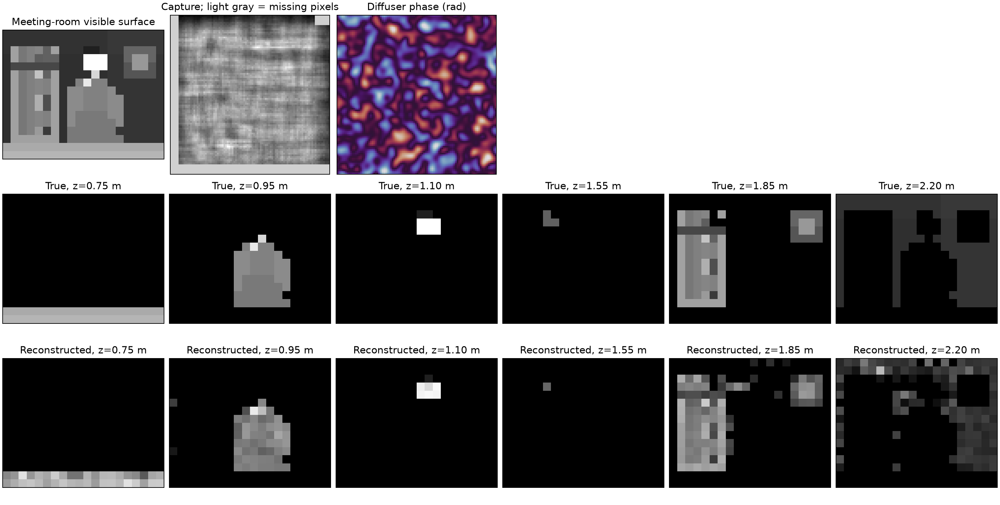

# Lens-Free Camera

无镜头散射成像仿真演示。这个公开仓库保存演示材料和可复用的仿真结果，不包含重建实现代码。

## 场景与采集

演示场景是一个带人物、书架、植物和墙面装饰的视频会议室。模拟使用固定随机相位散射片、部分缺失的传感器像素，以及 6 个深度层上的 20×16 横向体素网格。96×96 传感器中有 8,136 个有效采样点。

图中包含可见表面、散射片后的传感器图案、相位屏，以及真实和重建的各深度切片。灰色测量区域表示缺失像素。

## 一次固定种子的结果

| 指标 | 结果 |
| --- | ---: |
| 场景与相位屏 seed | 7 |
| 体素数 | 1,920 |
| 深度层数 | 6 |
| 残差引导深度精修轮数 | 6 |
| 相对传感器拟合残差 | 0.0163 |
| 深度 argmax 准确率 | 0.944 |
| 体积相对误差 | 0.249 |

这些指标来自合成场景。模拟设置包含 500,000 期望光子计数、相对 L1 强度 0.003、空间平滑强度 0.03，以及相对残差门限 0.05。它们不代表真实光学硬件的测量精度。

## 跨相位屏和噪声检查

[稳定性结果表](data/depth_stability_sweep.csv)记录 phase seed 7、12、13、14，在三种高斯读出噪声强度下的基线和门控精修指标。相位屏 seed 改变散射编码；泊松采样器使用 `phase_seed + 1` 作为固定种子。噪声 `0.002` 和 `0.005` 是仿真压力测试值，不是按传感器规格标定的噪声范围。

无高斯噪声的四组检查中，6 轮精修都降低了体积误差。较高读出噪声使初始相对残差超过 0.05，此时门控跳过深度交换，保留初始单表面支持。噪声会显著降低绝对深度准确率；门控只能避免精修进一步扰动结果，不能恢复测量中缺失的深度信息。

## 下载结果数据

[`meeting_scene_results.npz`](data/meeting_scene_results.npz)（约 55 MB）包含相位屏、网格坐标、部分标定 PSF、有效像素掩膜、测量、真实体积、重建体积和运行参数。NPZ 中体积数组轴序为 `(z, y, x)`。

## 边界

这是标量衍射与非相干可见表面亮度的数值原型。它不模拟宽光谱、厚散射片、多次散射、阴影、互反射或传感器饱和。单张二维测量的三维反演可能欠定，结果依赖标定、噪声和场景先验。这里的深度精修是局部坐标更新，不保证全局最优。
