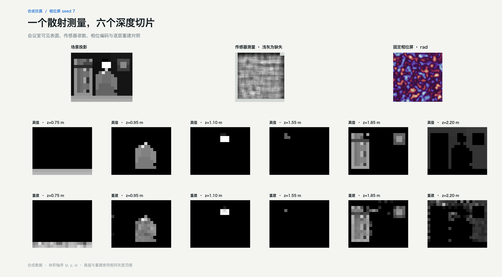
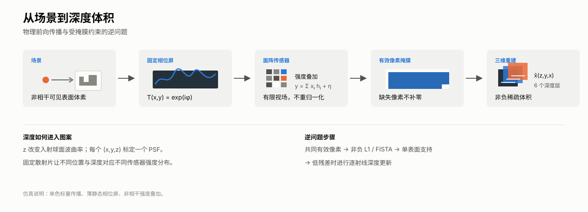

# 无镜头散射成像：技术与演示

这个仓库整理无镜头随机相位散射成像的数值演示材料。它覆盖固定相位屏标定、深度相关点扩散函数（PSF）、传感器缺失像素，以及从单幅二维强度图估计三维亮度体。这里展示的是合成仿真，不是实测硬件结果。

[English version](README.en.md) · [公开资料索引](README.md)

## 演示场景

场景模拟一个视频会议室，含人物半身、书架、书本、植物、墙面装饰和桌沿。正视投影在每个 `(x,y)` 位置只保留最近的可见表面。体素网格有 20×16 个横向位置、6 个深度，共 1,920 个候选体素；深度为 `0.75, 0.95, 1.10, 1.55, 1.85, 2.20 m`。体积数组轴序为 `(z,y,x)`。



图示包括真实可见表面、传感器测量、散射片相位，以及真实体积和重建体积的深度切片。缺失传感器像素以浅灰显示。更完整的原始结果图见 [meeting_scene_results.png](assets/meeting_scene_results.png)。

## 光学前向模型



模拟器把散射片表示为固定的薄随机相位屏 `T(x,y)=exp(i φ(x,y))`。相位由空间相关的随机场生成。点源 `(x_s,y_s,z)` 到散射片的距离 `z` 决定球面波曲率：

```text
r(x,y) = sqrt((x-x_s)^2 + (y-y_s)^2 + z^2)
U_d(x,y) ∝ exp(i 2π r / λ) / r
```

入射场在散射片采样面归一化为单位能量，再乘以相位屏。散射片到传感器的传播采用角谱法：

```text
U_s = F^-1{ F{U_d T} H(f_x,f_y) }
H = exp(i k L sqrt(1 - (λ f_x)^2 - (λ f_y)^2))
```

其中 `L` 是散射片到传感器距离，`k=2π/λ`。模拟器对复场零填充以降低 FFT 周期边界回绕，并舍弃倏逝频率。点源 PSF 是传感器面上的强度 `h_j=|U_s|^2`。传感器有限视场外的能量不作重新归一化，因此 PSF 和表示有限采样面捕获的能量比例。

场景光源按非相干强度相加：`y = Σ_j x_j h_j + η`。`x_j` 是体素亮度系数，`η` 表示光子采样和可选读出噪声。标定和测量共同缺失的位置使用同一有效掩膜；无效像素不补零，也不参与拟合。

## 重建过程

1. **体素标定：** 对每个 `(x,y,z)` 位置计算一张 PSF。深度改变入射球面波曲率，因此同一横向位置会有不同标定图案。
2. **掩膜与归一化：** 仅取测量和所有相关标定 PSF 都有效的传感器像素。每张 PSF 在拟合内部按 L2 范数归一化，返回时恢复亮度尺度。
3. **非负稀疏反演：** FISTA 近似求解 `0.5 ||D x-y||² + λ||x||₁`，约束 `x≥0`。可选空间项对每个深度层的 x/y 邻接差分做二次惩罚。
4. **单表面支持：** 对不透明场景，初始体估计在每条 `(x,y)` 射线上选取最大亮度深度，然后只在这些被选中的 PSF 上重估亮度。
5. **残差门控深度更新：** 若初始有效像素拟合残差不高于阈值，则逐射线比较各标定深度在去除当前射线贡献后的 L1 目标分数，并更新支持；若残差过高则保留初始支持。更新顺序由固定 seed 决定，迭代至设定轮数或无变化。

最后一步是局部坐标优化，依赖初始支持和噪声，不保证全局最优。它要求 `single_surface=True`，不适合透明或同一视线有多个真实深度的体积。

## 默认配置与演示结果

| 参数 / 指标 | 值 |
| --- | ---: |
| 波长 | 532 nm |
| 传感器与相位屏采样 | 96×96，像素间距 8 μm |
| 散射片到传感器距离 | 3 mm |
| 相位屏标准差 / 相关长度 | 2.5 rad / 2 px |
| 有效传感器样本 | 8,136 / 9,216 |
| 光子计数参数 | 500,000 |
| 相对 L1 / 空间平滑 | 0.003 / 0.03 |
| 深度精修轮数 / 残差门限 | 6 / 0.05 |
| seed 7 体积误差 | 0.249 |
| seed 7 深度 argmax 准确率 | 0.944 |
| seed 7 传感器相对残差 | 0.0163 |

| 相位 seed | 无高斯噪声基线误差 | 门控精修误差 | 基线深度准确率 | 门控精修深度准确率 |
| ---: | ---: | ---: | ---: | ---: |
| 7 | 0.2595 | 0.2546 | 0.9344 | 0.9500 |
| 12 | 0.2701 | 0.2567 | 0.9094 | 0.9219 |
| 13 | 0.2723 | 0.2588 | 0.9125 | 0.9344 |
| 14 | 0.3199 | 0.3064 | 0.9094 | 0.9187 |

[查看深度误差变化图](assets/depth-error-reduction.zh-CN.png) · [查看全部逐 seed/noise 数据](data/depth_stability_sweep.zh-CN.csv)。`0.002` 和 `0.005` 的高斯噪声是归一化测量单位下的压力测试值，不是按特定相机规格校准的读出噪声。在这些条件下，初始传感器残差超过 `0.05`，门控跳过深度更新。噪声仍会大幅降低绝对深度准确率。

## 动画与数据

[观看中文动画演示](assets/demo.zh-CN.gif)。英文动画见 [demo.en.gif](assets/demo.en.gif)。这是无音轨的 GIF 动画，不是相机实拍视频。

[`meeting_scene_results.npz`](data/meeting_scene_results.npz) 约 55 MB，包含相位屏、坐标、部分标定 PSF、测量掩膜、测量图、真实体积、重建体积和主要参数。主要数组形状：`calibration_psfs_partial=(1920,96,96)`，`measurement=(96,96)`，`true_volume=(6,16,20)`，`reconstructed_volume=(6,16,20)`。`depth_stability_sweep.zh-CN.csv` 提供逐 seed 指标。

## 可重复性与限制

默认演示使用相位屏 seed 7、泊松采样器 seed 8。相位屏 seed 会改变 PSF 字典，因此不同 seed 是不同光学编码；泊松噪声也会引入一次实现差异。报告的指标由合成真值直接计算，真实实验一般没有逐像素真值。

模型假设单色、静态薄相位屏、标量传播和非相干可见表面。它不包含宽光谱、厚散射片内部多次散射、阴影、互反射、饱和或暗电流。单张二维测量对三维体积通常欠定；任何稀疏或平滑先验都不能找回系统从未编码的信息。残差阈值 `0.05` 是当前合成例子的门控值，不能直接当作通用设备阈值。

更多细节见[技术说明](docs/technical-notes.zh-CN.md)和[实验说明](docs/validation.zh-CN.md)。
