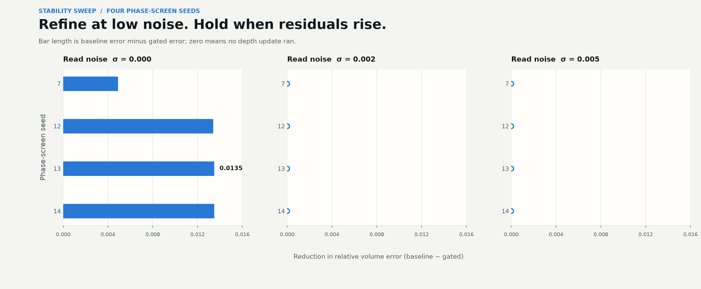
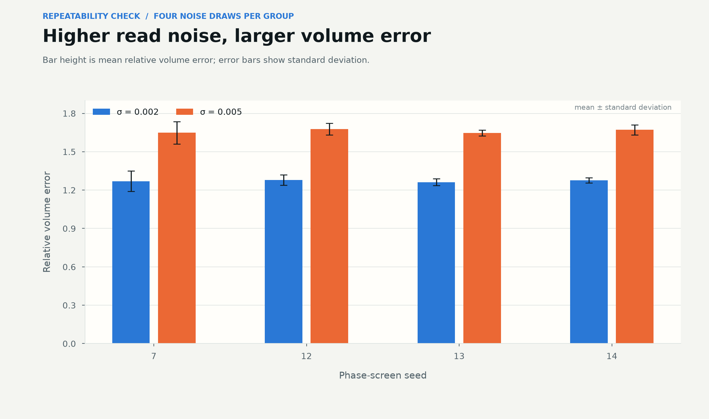

# Evaluation and Metrics

[简体中文](validation.zh-CN.md) · [Project home](../README.en.md) · [Technical notes](technical-notes.en.md)

## Metric definitions

| Metric | Definition | Interpretation |
| --- | --- | --- |
| Relative volume error | `||x_hat-x_true||₂ / ||x_true||₂` | Normalized L2 error over the full `(z,y,x)` volume; lower is better |
| Depth argmax accuracy | `mean(argmax_z(x_hat)==argmax_z(x_true))` | Fraction of `(x,y)` rays whose maximum-brightness depth matches; higher is better |
| Relative sensor residual | `||M(Hx_hat-y)||₂ / ||My||₂` | Computed only on common valid pixels; `M` selects valid samples |

Ground-truth metrics are available here only because the scene is synthetic. Physical experiments usually need calibration data, repeatability, or known targets and cannot directly report these accuracy values.

## Fixed-setting phase-seed sweep

The sweep uses phase seeds `7,12,13,14` with the same depth grid, phase-screen parameters, sensor mask, regularization, and photon-count setting. The Poisson RNG uses `seed+1` for each phase seed. One fixed noise realization is used for each seed/noise pair. We compare the base single-surface reconstruction (0 refinement rounds) with 6 residual-gated rounds at threshold `0.05`.

| Gaussian read-noise std | Seeds where refinement ran | Mean volume error, base → gated | Mean depth accuracy, base → gated | Mean sensor residual, base → gated |
| ---: | ---: | ---: | ---: | ---: |
| 0.000 | 4 / 4 | 0.2805 → 0.2691 | 0.9164 → 0.9313 | 0.0170 → 0.0165 |
| 0.002 | 0 / 4 | 1.2616 → 1.2616 | 0.3828 → 0.3828 | 0.2503 → 0.2503 |
| 0.005 | 0 / 4 | 1.6643 → 1.6643 | 0.2258 → 0.2258 | 0.5430 → 0.5430 |

With no additional Gaussian term, residuals are below threshold for all four seeds, refinement runs, and volume error falls. In the two stronger noise stress tests, residuals exceed `0.05`; the gate skips depth swaps for every seed, leaving the base reconstruction unchanged. Accuracy remains low at high noise, so preserving support is not the same as recovering depth information.

Full per-seed data: [CSV in English](../data/depth_stability_sweep.en.csv) · [CSV 中文版](../data/depth_stability_sweep.zh-CN.csv).

## Repeated noise-realization check

To check dependence on a single noise draw, four independent Gaussian-noise realizations were generated for each phase seed and noise level. Values below are means and standard deviations over those four draws using the gated defaults. All these high-noise measurements had initial residuals above threshold, so depth refinement was skipped. Phase seeds still represent different PSF encodings.

| Gaussian noise | Phase seed | Mean volume error ± SD | Mean depth accuracy ± SD | Mean sensor residual |
| ---: | ---: | ---: | ---: | ---: |
| 0.002 | 7 | 1.2690 ± 0.0798 | 0.3617 ± 0.0381 | 0.2457 |
| 0.002 | 12 | 1.2792 ± 0.0404 | 0.3656 ± 0.0167 | 0.2481 |
| 0.002 | 13 | 1.2621 ± 0.0264 | 0.3773 ± 0.0150 | 0.2494 |
| 0.002 | 14 | 1.2766 ± 0.0201 | 0.3367 ± 0.0336 | 0.2484 |
| 0.005 | 7 | 1.6482 ± 0.0867 | 0.2211 ± 0.0337 | 0.5336 |
| 0.005 | 12 | 1.6763 ± 0.0461 | 0.2242 ± 0.0155 | 0.5394 |
| 0.005 | 13 | 1.6472 ± 0.0228 | 0.2375 ± 0.0058 | 0.5409 |
| 0.005 | 14 | 1.6710 ± 0.0394 | 0.2148 ± 0.0068 | 0.5398 |

Gaussian noise standard deviation is expressed in normalized image-intensity units. These are stress tests, not noise calibrations for a specific sensor. Depth accuracy still varies across noisy realizations; the gate only prevents coordinate refinement from changing support under a poor fit.

Aggregated repeat results: [CSV in English](../data/noise_repeats.en.csv) · [CSV 中文版](../data/noise_repeats.zh-CN.csv).

## Default demo snapshot

The formal seed-7 demo reports relative volume error `0.249`, depth accuracy `0.944`, and relative sensor residual `0.0163`. This is one synthetic-scene run, not a cross-seed average. It should not be conflated with the separate fixed-setting sweep above, which uses its own measurement mask and evaluation run. See the [English reconstruction overview](../assets/reconstruction-overview.en.png) and the [full original figure](../assets/meeting_scene_results.png).

## Interpretation limits

The residual threshold is a conservative model-fit check, not a noise-variance estimator. It does not identify whether a poor fit comes from noise, PSF calibration errors, model drift, wavelength changes, or exposure mismatch. A physical system should select its threshold using independent calibration data and known-depth targets, then report repeated-measurement statistics. A single 2D intensity image may underdetermine a 3D volume, and a single-surface prior may exclude real multi-layer structure.
