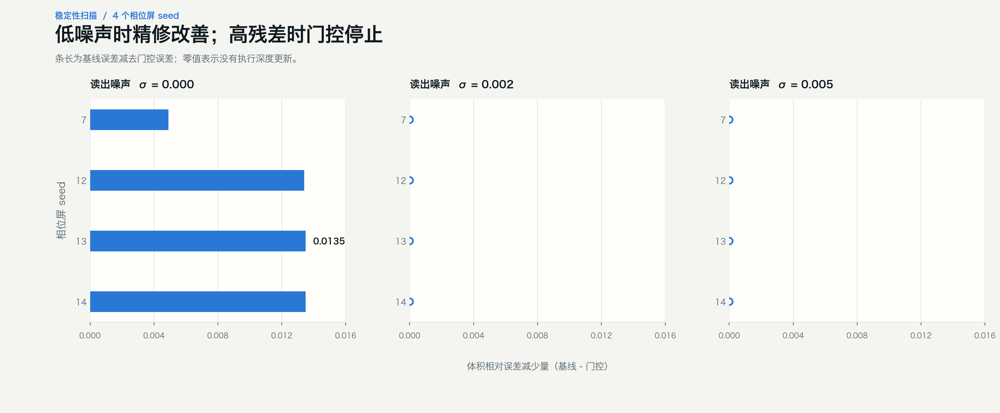
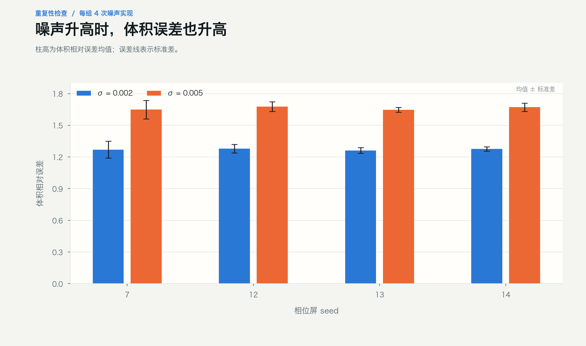

# 实验与指标说明

[English](validation.en.md) · [项目首页](../README.zh-CN.md) · [技术说明](technical-notes.zh-CN.md)

## 指标定义

| 指标 | 计算方式 | 解释 |
| --- | --- | --- |
| 体积相对误差 | `||x_hat-x_true||₂ / ||x_true||₂` | 整个 `(z,y,x)` 体积的归一化 L2 误差，越低越好 |
| 深度 argmax 准确率 | `mean(argmax_z(x_hat)==argmax_z(x_true))` | 逐 `(x,y)` 比较最大亮度深度，越高越好 |
| 传感器相对残差 | `||M(Hx_hat-y)||₂ / ||My||₂` | 仅在共同有效像素上计算；`M` 是有效像素选择算子 |

上述真值指标只适用于仿真，因为构造器提供了合成体积真值。真实实验通常只能使用校准数据、重复性或已知目标评估，不能直接使用这些精度数字。

## 固定设置的跨相位 seed 扫描

扫描固定相位 seed `7,12,13,14`，深度网格、相位屏参数、掩膜、重建正则项和光子计数保持一致。每个 seed 的泊松 RNG 使用 `seed+1`。对每种噪声和 seed 使用一次固定噪声实现。比较基础单表面重建（0 轮）与 6 轮、阈值 `0.05` 的残差门控精修。

| 高斯读出噪声标准差 | 门控执行精修的 seed 数 | 平均体积误差，基线 → 门控 | 平均深度准确率，基线 → 门控 | 平均传感器残差，基线 → 门控 |
| ---: | ---: | ---: | ---: | ---: |
| 0.000 | 4 / 4 | 0.2805 → 0.2691 | 0.9164 → 0.9313 | 0.0170 → 0.0165 |
| 0.002 | 0 / 4 | 1.2616 → 1.2616 | 0.3828 → 0.3828 | 0.2503 → 0.2503 |
| 0.005 | 0 / 4 | 1.6643 → 1.6643 | 0.2258 → 0.2258 | 0.5430 → 0.5430 |

无额外高斯噪声时，4 个 seed 的门控残差均低于阈值，精修全部执行且体积误差下降。两个更高噪声压力测试的残差均超过 `0.05`，门控对所有 seed 跳过深度交换，所以指标与基础重建相同。高噪声下准确率仍然较低，这说明门控保护现有支持不等同于恢复深度信息。

完整逐 seed 数据：[CSV 中文版](../data/depth_stability_sweep.zh-CN.csv) · [CSV English](../data/depth_stability_sweep.en.csv)。

## 多噪声实现重复检查

为检查固定噪声 seed 的偶然性，在每个相位 seed 和噪声级别下另生成 4 个独立高斯噪声实现。以下是门控默认参数下的均值和标准差；均值以 4 次实现计算。所有这些高噪声测量的初始残差都高于阈值，因此深度精修跳过。不同相位 seed 仍有不同的 PSF 编码。

| 高斯噪声 | 相位 seed | 体积误差均值 ± 标准差 | 深度准确率均值 ± 标准差 | 传感器残差均值 |
| ---: | ---: | ---: | ---: | ---: |
| 0.002 | 7 | 1.2690 ± 0.0798 | 0.3617 ± 0.0381 | 0.2457 |
| 0.002 | 12 | 1.2792 ± 0.0404 | 0.3656 ± 0.0167 | 0.2481 |
| 0.002 | 13 | 1.2621 ± 0.0264 | 0.3773 ± 0.0150 | 0.2494 |
| 0.002 | 14 | 1.2766 ± 0.0201 | 0.3367 ± 0.0336 | 0.2484 |
| 0.005 | 7 | 1.6482 ± 0.0867 | 0.2211 ± 0.0337 | 0.5336 |
| 0.005 | 12 | 1.6763 ± 0.0461 | 0.2242 ± 0.0155 | 0.5394 |
| 0.005 | 13 | 1.6472 ± 0.0228 | 0.2375 ± 0.0058 | 0.5409 |
| 0.005 | 14 | 1.6710 ± 0.0394 | 0.2148 ± 0.0068 | 0.5398 |

高斯噪声标准差用归一化图像强度单位表示。这些值是压力测试，不是对某类传感器的标定。噪声较大时，不同实现的深度准确率仍会波动；门控只阻止坐标精修在差拟合条件下继续改变支持。

聚合重复结果表：[CSV 中文版](../data/noise_repeats.zh-CN.csv) · [CSV English](../data/noise_repeats.en.csv)。

## 默认演示快照

默认相位 seed 7 的正式演示报告体积相对误差 `0.249`、深度准确率 `0.944`、传感器相对残差 `0.0163`。这是一次合成场景结果，不是跨 seed 平均，也不应与上面固定设置脚本中不同掩膜/结果表格混为一谈。结果图见 [中文重建概览](../assets/reconstruction-overview.zh-CN.png) 和[完整原图](../assets/meeting_scene_results.png)。

## 解读边界

残差门限是对模型失配和噪声的保守检查，不是噪声方差估计器。它不会自动判断 PSF 标定错误、模型漂移、波长变化或曝光误差的来源。真实系统应使用独立标定集与已知深度目标选择门限，并报告多次采集统计。单幅二维强度图对 3D 体积可能欠定，单表面先验也可能排除真实多层结构。
